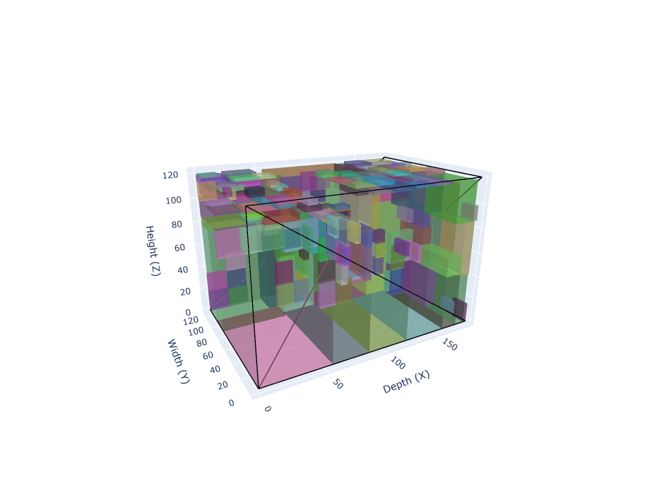
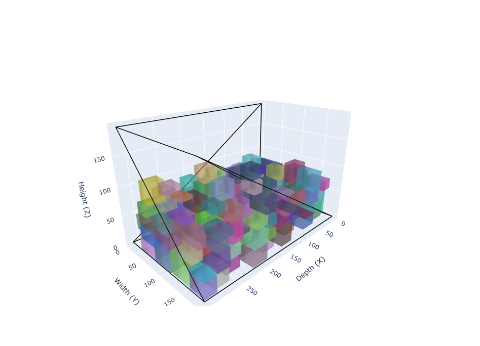

# 3D Bin Packing with Real-World Loading Constraints

Extreme Point heuristics for the constrained three-dimensional bin packing problem, implemented from scratch in Python.
B.Sc. thesis in Management Engineering, Politecnico di Torino (2026) · Supervisor: Prof. Fabio Salassa

> **Full title:** *A comparison of best-fit and first-fit Extreme Point heuristics for the constrained Three-Dimensional Bin Packing Problem — with an analysis of the sensitivity to item ordering*
> 📄 [Read the full thesis (PDF)](docs/thesis.pdf)

<table>
  <tr>
    <td align="center"></td>
    <td align="center"></td>
  </tr>
  <tr>
    <td align="center"><sub>Small van: volume 94%, payload 51%</sub></td>
    <td align="center"><sub>Large van: volume 32%, payload 100%</sub></td>
  </tr>
</table>

<sub>The same 1,000-item consignment loaded by first-fit on the two vehicles, rendered by the project's interactive 3D visualizer. The small van fills up in space; the large one runs out of payload with two thirds of its floor empty.</sub>

---

## The problem

A local distributor has to ship a set of heterogeneous parcels with identical vans (unlimited fleet). The goal is to **minimise the number of vans** while respecting:

- **geometry:** every parcel fully inside the van, no overlaps;
- **payload:** maximum weight per van;
- **insured value:** maximum total value per van;
- **orientation:** allowed rotations defined **per item** (up to 6 orientations, depending on the type of goods);
- **stability:** minimum supported fraction of the base defined **per item**, according to its fragility. In the literature this is usually a single parameter for all items.

The thesis also states the full MILP model (Chen, Lee & Shen formulation with big-M constraints); the experiments use the heuristics only.

## Approach

- **Extreme Point heuristic** (Crainic, Perboli & Tadei, 2008), implemented from scratch: no solvers or optimisation libraries. Each placed item offers three new candidate positions, which are projected onto the nearest obstacle.
- **Two placement rules, compared head to head:**
  - **best-fit** evaluates every feasible position and picks the one with the best merit (residual space);
  - **first-fit** stops at the first feasible position.

  They are kept as separate functions on purpose, so that first-fit never pays for merit computations it does not use and the runtime comparison stays fair.
- **Item ordering:** decreasing base area, height and weight. For the sensitivity analysis, at each step the next item is picked at random with probability *p* ∈ {0, 10, 20, 30%}, with a fixed seed.
- **Implementation detail:** when a new extreme point is created, its residual space is initialised by also scanning the items already loaded, so that free space is never overestimated.

## Experimental setup

| | |
| --- | --- |
| Instances | 50, from a seeded generator (seed `20260804`), plus 2 small demo instances |
| Items | 7,130 in total, 18 to 1,000 per instance |
| Product mix | 19 realistic product categories, 16 assortment profiles |
| Vehicles | Large van `furgone_ducato_medio`: 187×312×193 cm, 11.26 m³, 1,200 kg · Small van `furgone_torino_piccolo`: 125×182×121 cm, 2.75 m³, 660 kg |
| Runs | 800 = 50 instances × 2 rules × 4 randomisation levels × 2 vehicles |
| Validation | independent solution checker (no shared code with the solver): **all 200 solutions feasible** |

## Key results

| | Large van | Small van |
| --- | --- | --- |
| Vans used, first-fit vs best-fit | same result on 50/50 instances | first-fit better on 9/50 (138 vs 147 vans in total) |
| Total runtime, first-fit vs best-fit | 74 s vs 523 s (**7.1× faster**) | 148 s vs 355 s (**2.4× faster**) |
| Instances at the continuous lower bound | 48/50 for both rules (avg. gap 1.0%) | first-fit 30/50 (avg. gap 24.8% vs 36.9%) |
| Binding constraint | **weight** on 49/50 (avg. volume use 23%) | volume on 42/50 (avg. volume use 47%) |
| Instances sensitive to item order | 2/50 | 17/50 (15 worse, 2 better by up to 20%) |

**Takeaways**

1. The simpler rule wins: first-fit is **never worse** than best-fit and is always faster.
2. On the large van, payload, not volume, limits the load: a van with the same volume and twice the payload would need fewer trips.
3. Item ordering matters more than the placement rule: a randomised multi-start on the ordering is the most promising next step.

**Limitations:** no improvement phase (e.g. local search), no comparison with an exact solver, no load-bearing constraints.

## Repository structure

```
datasets/                              52 instances (Dataset1-50, dataset_prova_1-2): items.csv and vehicles.csv
Dataset Tesi Realistici Generati/      seeded instance generator, schema validator and methodological notes
instances/                             dataset loader
s324305_3d_packing_algorithm/          solver: Item, Container, PackingMethods, best-fit / first-fit
writing_and_checking_solutions/        3D visualizer (Plotly) and checker for a single solution
main.py                                run both rules on one instance and one vehicle
generate_vehicle_comparison.py         the full experimental campaign (produces thesis_results_only_csv/)
generate_randomization_comparison.py   sensitivity-to-ordering runs (used by the campaign)
validate_all_solutions.py              independent check of all 200 stored solutions
thesis_results_only_csv/               results: 8 files per instance, 50 instances
docs/                                  thesis PDF and README images
requirements.txt                       pinned dependencies
```

Code comments and output tables are in Italian. All scripts must be launched **from the repository root** (data paths are relative).

## How to run

Requires Python 3.11+ (developed and run with Python 3.14.3 and the versions pinned in `requirements.txt`).

```bash
python -m venv .venv
source .venv/bin/activate          # Windows: .venv\Scripts\activate
pip install -r requirements.txt
```

**One instance.** Set `dataset_name` and `vehicle_type` at the top of `main.py`, then:

```bash
python main.py
```

It writes the best-fit and first-fit solutions, their comparison and the ordering-sensitivity table to `thesis_results_only_csv/Solution <dataset>/`.

**Whole campaign** (50 instances × 2 vehicles, the script behind the thesis results):

```bash
python generate_vehicle_comparison.py
```

It rewrites `thesis_results_only_csv/`; expect roughly one to two hours on a laptop-class CPU (estimate), most of it spent on the largest instances. Solutions and vehicle counts are deterministic (fixed seeds), so they match the files in the repository; only the timing columns depend on the machine.

**Verify the solutions.** Check bounds, overlaps, weight, value, support and completeness of all 200 stored solutions:

```bash
python validate_all_solutions.py
```

**3D visualisation.** The interactive HTML views are not stored in the repository (about 5 MB each). To produce one, call `solve(write_html=True, vehicle_type=...)` on the solver (see `main.py`); the file is written to `thesis_results_with_images/` and opens in any browser. `writing_and_checking_solutions/results_checker_thesis.py` checks the feasibility of one such file.

**Regenerate the instances** (optional):

```bash
cd "Dataset Tesi Realistici Generati"
python generate_datasets_v2.py     # writes datasets_rigenerati/, does not touch ../datasets
python validate_v2.py              # validates ../datasets
```

### Data formats

- `items.csv`: `id, width, depth, height, weight, value, allowedRotations, gravityStrength` (cm, kg, EUR; `allowedRotations` is a string of digits 0–5; `gravityStrength` is the minimum supported fraction of the base, in %).
- `vehicles.csv`: `type, width, depth, height, maxWeight, maxValue`, identical in every instance.
- Solution files: `type_vehicle, idx_vehicle, id_item, x_origin, y_origin, z_origin, orient`. Axes: x along depth, y along width, z along height; `orient` 0–5 maps (width, depth, height) to (w,d,h), (d,w,h), (h,d,w), (d,h,w), (w,h,d), (h,w,d).
- Per instance, `thesis_results_only_csv/Solution <dataset>/` holds: the two solution files per vehicle (`*_solution_bestFit_*`, `*_solution_firstFit_*`), a best-fit vs first-fit comparison per vehicle (`*_comparison_bestFit_firstFit_*`), `*_comparison_4_simulazioni.csv` (vehicles used and runtime, both rules and vehicles) and `*_comparison_16_simulazioni.md` (vehicles used for the 16 combinations of rule, randomisation level and vehicle).

## References

- T. G. Crainic, G. Perboli, R. Tadei (2008). *Extreme Point-Based Heuristics for Three-Dimensional Bin Packing.* INFORMS Journal on Computing, 20(3), 368–384.
- C. S. Chen, S. M. Lee, Q. S. Shen (1995). *An analytical model for the container loading problem.* European Journal of Operational Research, 80(1), 68–76.

## Acknowledgements

The instance format, the dataset loader and the first version of the single-solution checker come from the *Bin-Packing-Environment* provided for the Operations Research course at Politecnico di Torino. The solver, the instance generator, the batch validator and the 3D visualizer (rewritten from the course version) were developed for this thesis.

## Author

**Riccardo Quariglio** · M.Sc. student in Data Science and Engineering, Politecnico di Torino
<!-- TODO: add LinkedIn URL -->
